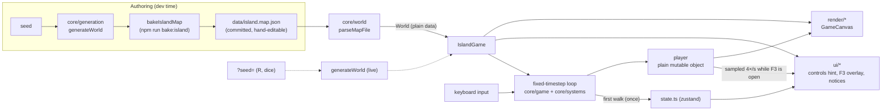
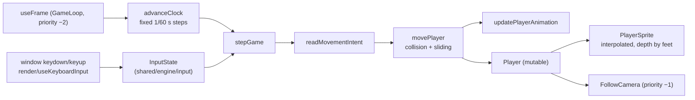
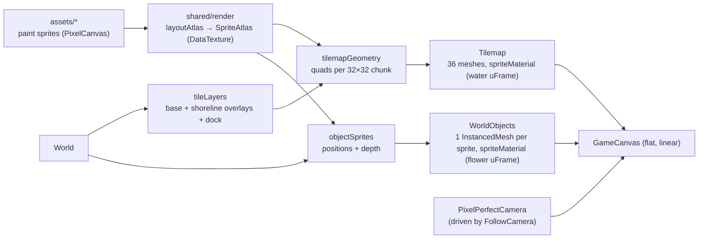

# Architecture

> Status: M4 (polish & handover) — all milestones delivered. Sections marked _(planned)_
> describe the design future work will implement; update them as the code lands.

## Layers

| Layer      | Folders                                                         | May import                            | Tech                |
| ---------- | --------------------------------------------------------------- | ------------------------------------- | ------------------- |
| App / site | `src/app`, `src/pages`                                          | all below (games only via `index.ts`) | React, react-router |
| UI         | `src/games/*/ui`, `src/shared/ui`                               | core, state                           | React DOM           |
| Render     | `src/games/*/render`, `src/games/*/assets`, `src/shared/render` | core, state                           | R3F, three, drei    |
| Core       | `src/games/*/core`, `src/shared/engine`                         | core only                             | Pure TypeScript     |

Dependency direction: **app → ui / render → core**. UI and render are siblings and don't import
each other; the game's root component (`IslandGame.tsx`) composes them. Shared code never
imports a game. All of this is enforced by `no-restricted-imports` blocks in
`eslint.config.js` and verified by `tests/layer-rules.test.ts`.

## Routes

| Route         | What                                                                                                                                                                                                                           |
| ------------- | ------------------------------------------------------------------------------------------------------------------------------------------------------------------------------------------------------------------------------ |
| `/`           | **The island**, full screen, no site chrome (lazy; a cosy loading screen on first load: the pixel cottage with chimney smoke and gentle village lines). `?seed=N`: a generated island (R / dice button; Home goes back to `/`) |
| anything else | Redirects to `/`, keeping the query string                                                                                                                                                                                     |

The browser tab title is "Slow Living · Charles", with a pixel-art cottage icon (`index.html`;
`public/favicon.svg`, `favicon-32.png`, `apple-touch-icon.png`).

## Folder map

```
src/
  main.tsx                  # Entry: mounts <App/>
  app/                      # App shell: router (HydrateFallback, catch-all redirect), global.css
  pages/                    # WorldPage (/, ?seed= → IslandGame, navigation), RedirectToIslandPage,
                            #   RouteLoadingPage, RouteErrorPage
  shared/
    engine/                 # Pure TS: math, random, noise, grid, pathfinding (A*)
    render/                 # pixelCanvas, atlasLayout, spriteAtlas, pixelPerfect, PixelPerfectCamera
    audio/                  # Web Audio, no React: song (data + timing, pure), voices (synths),
                            #   musicGraph (mix, lo-fi filter, echo, hiss; live or offline),
                            #   ticker (worker timer), musicPlayer (scheduler, mute, pause)
    ui/                     # (planned) shared UI components
  games/
    island/
      index.ts              # Public API: IslandGame
      IslandGame.tsx        # Loads the world, creates GameState; composes render + UI overlays
      loadWorld.ts          # Baked home island, or a generated one for ?seed=; never throws
      state.ts              # zustand store, UI-facing only: debug overlay, has-walked, music muted
      data/island.map.json  # THE world: baked, committed map file (chunked, readable)
      core/
        config.ts           # IslandConfig: every tunable number
        content/            # portfolio.ts (the portfolio: panels of pages), studio.ts (piece → panel),
                            #   portfolioHtml.ts (static HTML + JSON-LD for index.html, at build),
                            #   guidance.ts (villager talks, sign labels)
        world/              # tiles, objects (registries), world (type), collision,
                            #   mapFile (format + writer), parseMapFile, bakedIsland (loader)
        generation/         # authoring tool: context, steps/*, validate, pipeline,
                            #   generateWorld, bakeIslandMap, siteSearch (rect sums, route to trail)
        entities/           # player.ts (plain mutable player, feet hitbox)
        systems/            # controls (bindings, intent), movement (collision), animation
        game/               # gameState.ts: createGameState, stepGame, advanceGame;
                            #   mapTravel.ts: doors between maps
      render/               # GameCanvas, Tilemap (+ tileLayers, tilemapGeometry), spriteMaterial,
                            #   WorldObjects (+ objectSprites, objectSpriteKeys), worldSpace,
                            #   spriteCatalog, spriteGeometry, GameLoop, PlayerSprite,
                            #   FollowCamera, useKeyboardInput
      assets/               # palette (ramps), paint helpers, foliage (clump shading),
                            #   paintTiles/Transitions/Objects/Structures/Cabin/Cliff/Props/
                            #   Deadwood, playerPixels (parts) + sideLegs + playerFrames (strips),
                            #   paintPlayer, islandSprites, chillTune (the music, as data)
      # render also: CharacterSprite (player + villagers), VillagerSprites, InteractPrompt,
      #   DayNightLighting, StudioMarker; assets also: paintHouses, paintLights, paintUi,
      #   paintInterior (floor, walls, doormat), paintFurniture, paintStudio,
      #   paintStudioFurniture; core/world/interiors.ts (rooms: cottage, studio)
      ui/                   # ControlsHint (fades after first walk), DebugOverlay (F3, top-right),
                            #   DayNightToggle, MusicToggle,
                            #   DialogBox (messages), ScreenFade (door transitions),
                            #   ZoomButtons (phones), ResumeView (+ ResumeButton), DevSeedBadge,
                            #   WorldErrorPanel,
                            #   IslandSwitcher (dice / R / Home, fades then asks the page),
                            #   StudioVisitMemory (remembers the first studio visit),
                            #   PortfolioPanel + PortfolioPageView (the portfolio card)
tests/                      # Cross-cutting tests (architecture rules)
scripts/
  bake-island-map.mjs       # npm run bake:island [-- seed]: generator -> data/island.map.json
  island-overview.mjs       # npm run overview:island -- out.png [first] [count]: seed contact sheet
  browser-check.mjs         # Dev-only headless Chrome check (keys, screenshot, FPS, console)
```

## Data flow



## The world is a baked map file

- The live island is **not generated at runtime**. `data/island.map.json` is produced once by
  the generator (`npm run bake:island`), committed, and loaded by `loadBakedIsland()`.
  Changing generation code never moves anything in the live world; only re-baking or editing
  the file does. `bakedIsland.test.ts` guarantees the committed file passes every invariant.
- **Format (version 1):** header (`chunkSize`, `widthChunks`, `heightChunks`, `spawn`,
  `source` seed info) + `chunks[]`. Each chunk has chunk coordinates `x`/`y`, `rows` (one
  string per tile row, one character per tile — `mapChar` in the tile registry) and
  `objects` as `[kind, localX, localY]`. Written one row/object per line for readable diffs.
- **Tile characters:** `~` deep sea, `-` shallow sea, `.` sand, `,` grass, `L` lake water,
  `l` lake shallows, `=` path, `#` dock.
- `parseMapFile` checks everything (version, sizes, known tiles/objects, overlaps, exactly
  one cabin, spawn in bounds) and throws `MapFileError` with a precise message, which the UI
  shows in `WorldErrorPanel`.

## World data

- `World` is plain data: `terrain: Uint8Array` (TileId per tile), `objects: WorldObject[]`
  (kind + top-left tile), `occupancy: Int32Array` (object id per tile or `NO_OBJECT`),
  `blocked: Uint8Array` (collision mask), `cabin`, `spawn`, `seed`, `generationSeed`.
- Grids are row-major (`index = y * width + x`) with **y growing downwards**. Render code
  flips y when converting to Three.js coordinates (y up).
- Rules about tiles and objects come from the registries (`isWalkableTile`, `waterBody`,
  `blocksMovement`, `footprint`, `door`), never from comparing ids in logic.

## Generation pipeline (authoring tool)

`shapeIsland → assignTerrain → carveLake → placeCabin → placeDock → layPaths → decorateCabin →
scatterRocks → scatterTrees → placeLedges → placeVillage → placeStudio → placeSignposts → scatterDeadwood → scatterFlowers →
chooseSpawn →
validate`

| Step              | What it does                                                                                                                                                                                                                                                                                                                                                                                                                                                                                                                                                                                                                               |
| ----------------- | ------------------------------------------------------------------------------------------------------------------------------------------------------------------------------------------------------------------------------------------------------------------------------------------------------------------------------------------------------------------------------------------------------------------------------------------------------------------------------------------------------------------------------------------------------------------------------------------------------------------------------------------ |
| `shapeIsland`     | Elevation = fractal noise blended with a radial gradient (`radialWeight`)                                                                                                                                                                                                                                                                                                                                                                                                                                                                                                                                                                  |
| `assignTerrain`   | Thresholds → deep/shallow sea, sand, grass; deep-sea edge band; keep the largest landmass; fill water not connected to the edge                                                                                                                                                                                                                                                                                                                                                                                                                                                                                                            |
| `carveLake`       | Noise-bent blob where the coast distance leaves room for lake + shore + gap; 8-way shallows rim and sand shore                                                                                                                                                                                                                                                                                                                                                                                                                                                                                                                             |
| `placeCabin`      | Site where footprint + margin + front clearance are grass, away from water, preferably near the lake (or nearest the `cabin.anchor` authoring hint); reserves the area                                                                                                                                                                                                                                                                                                                                                                                                                                                                     |
| `placeDock`       | Straight dock from a lake-shore sand tile into open water, on the side closest to the cabin door                                                                                                                                                                                                                                                                                                                                                                                                                                                                                                                                           |
| `layPaths`        | A* trails from the door to the dock and to beaches (closest, then farthest), noise-perturbed costs so they wind, existing trail is cheap so trails merge; trail tiles reserved                                                                                                                                                                                                                                                                                                                                                                                                                                                             |
| `decorateCabin`   | Fence around the cabin's front yard (trail tiles left open = gate), a mailbox beside the door, and props (bush, flower pot, barrel, sign, stepping stones, wood pile) on free grass inside the reserved area                                                                                                                                                                                                                                                                                                                                                                                                                               |
| `scatterRocks`    | Rock outcrops from cluster noise plus lone rocks, on free grass/sand                                                                                                                                                                                                                                                                                                                                                                                                                                                                                                                                                                       |
| `scatterTrees`    | Dense canopy (big trees on a staggered 2-tile grid) where forest cores meet a "dense" character noise; loose big/small mix elsewhere in forests; rare meadow trees and bushes; crowns never overhang reserved tiles                                                                                                                                                                                                                                                                                                                                                                                                                        |
| `placeLedges`     | Rocky ledges (`Cliff` terrain) in noise-picked runs on south-facing sea coasts: grass above, sea-connected beach below, grass/sand beside, away from trails; runs that would cut a beach off from the door are dropped                                                                                                                                                                                                                                                                                                                                                                                                                     |
| `placeVillage`    | An open village (`generation/villagePlan.ts`: random size and notched outline, recorded as the area villagers and animals keep to; 3 houses spread out, each lot holding its roof rows, garden and path row) at the best clear spot near the cottage; a 3×3 paved plaza (with a free ring if possible) nearest the doors; picket-fenced front gardens with a gap at the door; door paths to the plaza and a path on to the nearest trail; plaza furnishings (string lights, well, market stall, benches) and lamps, barrels, a haystack and stumps, never blocking a door; records `village` (interior spans + entrance, stored as `gate`) |
| `placeStudio`     | The Developer's Studio (7×4) at the spot nearest `studio.preferredDistanceTiles` from the cottage door: building on free grass, margin and two rows in front free grass or trail, fewest objects cleared; a path from its door to the nearest trail (`generation/siteSearch.ts`, shared with the village; trails keep off tiles next to a ledge)                                                                                                                                                                                                                                                                                           |
| `placeSignposts`  | A signpost beside the trail where it leaves the village (around the tile just outside the entrance, never on the trail); its text is worked out at runtime from the landmarks                                                                                                                                                                                                                                                                                                                                                                                                                                                              |
| `scatterDeadwood` | Sparse stumps (block) and fallen branches (flat) on free grass with enough trees nearby, outside reserved areas                                                                                                                                                                                                                                                                                                                                                                                                                                                                                                                            |
| `scatterFlowers`  | Patch noise → flower patches (colour from a colour noise), scattered flowers, grass tufts                                                                                                                                                                                                                                                                                                                                                                                                                                                                                                                                                  |
| `chooseSpawn`     | Tile in front of the cabin door if walkable                                                                                                                                                                                                                                                                                                                                                                                                                                                                                                                                                                                                |
| `validate`        | `validateMap` (works on generation contexts and loaded maps): deep-sea borders, land share, one lake not touching the sea, a dock, cabin on land, door + every trail/dock tile reachable from spawn, enough reachable land, every house door reachable, every beach below a ledge reachable                                                                                                                                                                                                                                                                                                                                                |

- Each step is a pure `(context) => context` function; it copies the arrays it changes.
- Each step draws from its own RNG stream, `createRng(deriveSeed(seed, stepName))`.
- `generateWorld` retries with `deriveSeed(seed, 'retry-N')` up to `generation.maxAttempts`.

## Game loop



- `GameCanvas` creates one `GameState` per world (`createGameState`): world, player, input,
  fixed-step clock, interpolation factor. It is a plain mutable object, never React state.
- Each rendered frame, `GameLoop` calls `advanceGame(state, delta)`, which runs the owed
  fixed steps (`stepGame`: read intent → face → `movePlayer` → `updatePlayerAnimation`) and
  stores the interpolation factor. Then `FollowCamera` eases towards the interpolated player
  position, and `PlayerSprite` draws it (pixel-snapped, facing strip, walk frame,
  `standingSpriteZ(feet)`).
- **Controls:** WASD/arrows walk in 4 directions: only the most recently pressed key that is
  still held moves (and faces) the player; releasing it falls back to the previous held key,
  and opposite keys don't cancel (D40). Shift runs, Space interacts, +/− zoom, F3 debug overlay, M mutes the music.
  Losing window focus releases all keys.
- **Collision:** a 10×6 px feet hitbox against `world.blocked`; X and Y move separately
  (wall sliding), stop flush at tile edges, and nudge around corners clipped by ≤ 5 px.
- Only UI-relevant values go into zustand: `isDebugOverlayVisible` (F3),
  `hasStartedWalking` (set once by `GameLoop`; the controls hint fades), `isMusicMuted` and
  `dialogMessage` (mirrored from `GameState.dialog` by `GameLoop`, only when it changes).
- **Day/night:** `GameState.timeOfDay` (0 = midnight, 0.5 = noon) advances every step
  (`dayNight.dayLengthSeconds`, 12 min; starts 0.33). `core/systems/dayNight.ts` turns time and
  mode (`auto` / `day` / `night`, a zustand UI flag set by `ui/DayNightToggle`) into a `Lighting`
  (tint + lights). `render/DayNightLighting` eases towards it each frame and writes shared
  uniforms (`render/lighting.ts`: `uTint`, `uLightsOn`) that every world material multiplies by,
  and tints the background. Buildings get a `<key>_lights` overlay (warm glass pixels, made by
  `assets/paintLights.ts`) drawn with `createLightsMaterial`: hard alpha, untinted, only while
  lights are on. The UI-layer arrow and dialog are not tinted.
- **Villagers:** `GameState.villagers` (one per village house, spawned at its door, `look` =
  one of the three characters in `assets/villagerParts.ts`) are `Player`-shaped, so they reuse `movePlayer`, the animation and
  `CharacterSprite`. `core/systems/wander.ts` rests, picks a random free tile in
  `wanderTiles(world)` (the recorded village area minus the strips behind houses) and follows an A* route restricted to that area (so villagers never
  leave the village), one axis at a time; a seeded `wanderRng` keeps sessions reproducible.
  Villagers keep out of each other's way: routes avoid tiles other villagers stand on or step
  onto next, no two head for the same tile, and a villager that still bumps into another plans
  a detour (or pauses briefly, keeping its goal). Only the player makes them wait.
  Villagers and the player block each other (`bumpsInto`, feet hitboxes). Talking (Space) makes
  the villager stop and face the player until the message closes. What they say comes from
  `core/content/guidance.ts` (a few conversations per character, taking turns via
  `timesTalked`), with `{studio}` filled in by `core/systems/guidance.ts` as the compass
  direction from the villager to the studio (`core/systems/compass.ts`).
- **Village life (D64):** `core/systems/animals.ts` moves three chickens and a cat inside the
  village area (pick a near open tile, walk straight, rest; never solid); `render/AnimalSprites`
  draws them (4-frame strips, mirrored when facing right). `render/ChimneySmoke` floats puffs
  from every chimney (positions from the cottage-style specs). The fireplace flickers
  (`FIRE_FRAME_COUNT`, its own material pair in `WorldObjects`).
- **Village day (D68):** `core/systems/routine.ts` (roles, `activityAt`, `routinePlaces`:
  stall, well, dock end, plaza bench, gathering spots; `updateRoutine` before `updateVillager`),
  errand routes via `planErrandRoute` in `wander.ts`, benches via `seat.ts`; greetings in
  `content/guidance.ts` + `villagerGreeting`; props drawn by `render/ChoreProps`; steam over the stall's loaves by
  `render/BreadSteam`. Washing lines come from the last generation step, `hangLaundry` (after the
  flowers, so earlier placements never change).
- **Hot spring:** `generation/steps/placeHotSpring.ts` (after the coop, before the spawn: quiet
  open grass away from the village and houses, among trees, near a trail; a clear walkable ring;
  validation requires it and a reachable side). The pool (`hot_spring`, 4×3, `ground` so it lies
  flat, but solid) is a `sit` seat with `soak`: `seat.ts` puts the sitter on one of two seats in
  the water (`sitting.soaking`, never two on one seat). `render/HotSpring` draws the pool's near
  half (`hot_spring_front`, everything below the water line) at the pool's bottom depth, so it
  hides a soaker from the chest down (`CharacterSprite` lifts soakers by `SOAK_LIFT_PX`), plus
  ripple rings and blended steam (`mist_steam_*`, one mist material per puff; thickness from
  `render/springSteam.ts`). The night owl soaks there late in the afternoon (`soak` activity).
  Sound: the `spring` layer (lapping bed + bubbles) by distance.
- **Chicken run:** `generation/steps/buildChickenCoop.ts` places the fenced pen (with a
  `fence_gate`), the hen house, a `feed_trough`, a `water_dish`, a `straw_patch` and `sunflower`s
  outside the fence; if no spot fits it tries closer to the village, then sand, then without the
  walkway (gate reachable and `quietSpots.staysConnected`), and `validateGeneration` requires it.
  `core/systems/animals.ts`: hens, a rooster and chicks (`isPoultry`); chicks keep
  `followOffset` from their mother (`follows`); hens and the rooster take `chores` (beside the
  trough and dish, `choreChance`) and face them; a bird whose rain spot is taken picks another
  free one, and settled birds are always gone round. `core/systems/rooster.ts`: `crowTimes`;
  `render/RoosterCrow` floats notes, `ui/AmbientSound` plays `crow` (layer `rooster`, by distance
  to the hen house). The hen house says what the hens are up to (`livePages`, `HEN_HOUSE_LINES`).
- **Beach campfire:** `generation/steps/placeCampfire.ts` (after the hot spring: a 4×4 patch
  with `log_bench`, two `log_stool_*` seats facing the fire and the 2×2 `campfire`, by the sea and
  touching the beach, nearest the village; the patch turns to sand, with a sandy strip to the beach
  if needed). Shared placement helpers: `generation/quietSpots.ts`. Seats are `sit` seats with
  `faces`; `seat.ts` picks the nearest free spot (`sitOn` returns false when all are taken:
  "Every seat is taken"). `core/systems/campfire.ts`: `campfireLit` (dusk to dawn) and
  `campfireEvening` (`GameState.day`, counted at midnight, every `everyDays`): the routine sends
  the gathering and the night owl to `routinePlaces.campfireSeats` instead of the well and the
  plaza bench. `render/Campfire` draws flames, sparks (untinted), the glow (`glow_campfire`,
  untinted mist material, faded in with the dark) and day smoke; `render/seatLift.ts` lifts
  sitters (and the guitar in `EveningMusic`). Sound: the `fire` layer outdoors, near the lit fire.
- **Calm (D67):** `core/systems/weather.ts` (clear spells, showers with an eased intensity,
  `rainyTint` used by `DayNightLighting`); `render/Rain` (instanced streaks sized to the view,
  lake rings) and `render/CloudShadows`. `core/systems/tour.ts` (stops, `tourPoint`) and
  `core/game/idleTour.ts` (idle timer, `noteActivity` from keys and taps, `cameraFocus` read by
  `GameCanvas`). `GameLoop` mirrors `calmMode` (resting / touring) into the store: the HUD
  fades or hides and `MusicToggle` makes the music mellow. Nature sounds:
  `shared/audio/ambiencePlayer.ts` + `ambienceSounds.ts`, mixed by `core/systems/soundscape.ts`,
  driven by `ui/AmbientSound`. Village sounds (chimes, voices, footsteps by ground, the bell) are
  in `shared/audio/villageSounds.ts`; footsteps follow `Player.footfalls`.
- **Wildlife (D66):** rabbits (`core/systems/rabbits.ts`) and a duck family
  (`core/systems/ducks.ts`: the mother follows smoothed routes over open lake water from
  `waterPaths.ts`, the ducklings follow her) are simulated in `GameState` on the island.
  Butterflies (day) and fireflies (night, window-light material) are render-only:
  `render/insectMotion.ts` gives a pose for a time, `render/ambientSpots.ts` picks their
  flowers and swarm spots.
- **Guidance (D60):** `GameState.landmarks` (studio door, village gate, cottage door) feed the
  villager hints and signposts: a `sign` (registry `signpost`) answers with one line per
  landmark that isn't right next to it ("The Developer's Studio: east"). Signs stand by the
  cottage gate (`decorateCabin`) and just outside the village gate (`placeSignposts`).
  `render/StudioMarker` floats a gold star over the studio until `hasVisitedStudio` (set by
  `GameLoop` on first entering the studio; remembered by `ui/StudioVisitMemory`).
- **Interaction:** an object kind with `interaction: { pages }` in the registry can be
  checked with Space. Each step, `findInteractTarget` looks one reach (`interaction.reachPx`) past
  the feet hitbox in the facing direction; `render/InteractPrompt` bobs a small down-arrow over that
  target. A fresh Space press (`consumePress`, one-shot presses in `shared/engine/input`) opens
  `GameState.dialog` (`{ pages, page }`); while it is open the player stands still and Space
  turns the page, closing after the last. `ui/DialogBox` shows the current page (no reply
  choices). Wall-mounted pieces (`wallMounted`) hang on an interior's back wall and answer when
  faced from the floor below.
- **Tap to walk (D63):** `render/TapToWalk` unprojects a tap through the camera and calls
  `tapAt`; `core/systems/tapToWalk.ts` plans the route (`planTap`) and `followWalk` turns it
  into movement intents each step (keys cancel it). On phones a finger held down (`touch.holdMs`)
  or slid steers instead: every frame the point under it is unprojected again (the island scrolls
  under a still finger) and `core/systems/steer.ts` picks the way (four ways, keeping the current
  axis until lined up, stopping `touch.stopTiles` short), pressed as `TOUCH_KEYS`; a ring sprite
  marks the spot. Sound starts on the first `pointerup` (a touch only counts as a gesture then). `GameState.overlayOpen` (the Résumé, via
  `setOverlayOpen` from `GameLoop`) pauses the player. `device.ts` (`isTouchFirst`) picks the
  phone camera framing (`render.touchTargetTilesAcross`) and phone-only UI.
- **Portfolio panel (D61):** an interaction can be `{ panel, pagePerTile? }` instead of pages.
  Opening sets `GameState.panel` (the player stands still); `GameLoop` mirrors it to the store's
  `panel`; `ui/PortfolioPanel` shows `PORTFOLIO[id]` page by page and closes it in the store;
  `GameLoop` then calls `closePortfolioPanel` (clears pending presses). Images and the CV are in
  `public/portfolio/`. The F3 overlay reads
  `game.framesPerSecond` (smoothed in `advanceGame`) and `playerTile` on a 250 ms timer while
  visible, so React never re-renders per frame.
- **Maps and doors (D57):** `GameState.maps` holds the island and every room from
  `core/world/interiors.ts`; `state.world`/`state.mapId` is the current one. `checkDoors`
  (`core/game/mapTravel.ts`) starts a `transition` when the player walks up into the door of a
  kind with `interior`, or stands on a doormat indoors; `stepTransition` fades out, swaps the
  map and places the player (`core/systems/doors.ts`), then fades in. `GameLoop` mirrors
  `mapId` and the dark phase to zustand; `GameCanvas` rebuilds the map-keyed layers and
  `ui/ScreenFade` fades the screen. Indoors, lighting turns warm at night and the camera
  zooms to fit the room.
- `GameState` is created by `IslandGame` (one per world) and passed to both `GameCanvas`
  (which drives it) and the UI overlays (which read it).
- Dev only: `window.__islandRenderer` exposes the WebGL renderer for performance and cleanup
  checks (`renderer.info`).

## Rendering



- **Units:** 1 world unit = 1 source pixel; a tile is 16 units. World y = −(map y in px).
- **Atlas:** sprites are painted in code into `PixelCanvas` buffers (`assets/`), packed by
  `layoutAtlas` (power-of-two, 1 px extruded borders) and uploaded as one nearest-filtered
  `DataTexture`. Keys: `tile_<tile key>.N` (variants), `edge_<material>_<n|e|s|w>`,
  `corner_<material>_<ne|se|sw|nw>`, `tile_dock_h|v`, `tile_cliff[_<w><e>].N` (ledge pieces by
  what is beside them: c ledge, g grass, s sand), `<object spriteKey>[.N]`, `cabin`.
  Variants are picked per position with `hashCoords`, so the same spot always looks the same.
- **Terrain:** `tileLayersAt` returns the sprites for a tile, bottom to top: base (the
  underlay's sprite for the dock), overlays from higher-`edgePriority` neighbours that have edge art (edges for
  touching sides, rounded corners for diagonal-only contact, lowest priority first), then the
  dock planks. Ledges rank with grass and have no edge art: they paint their own grass lip
  and beach foot, and nothing spills over them. `buildChunkGeometryData` turns a chunk into quads; animated water quads carry a
  u stride and the shader adds `stride × uFrame`.
- **Objects:** `objectSpriteKey` picks each object's sprite (fence pieces by neighbouring
  fences, otherwise a stable variant); `placeObjectSprites` stands sprites on the bottom edge
  of their footprint (big trees: 32×32 over a 2×1 trunk row; giant trees: 48×48 over 2×1,
  crown spilling one tile sideways; cottage: 96×96 over 6×4). One
  `InstancedMesh` per sprite key with the shared `spriteMaterial` (instancing-aware); flowers
  are 4-frame strips animated by the objects material's own `uFrame`.
- **Style:** classic handheld-RPG-inspired, original, painted in code: colour ramps
  (outline → dark → base → light → highlight), soft dark-green/brown outlines, crowns built
  from many small leaf clusters (`leafClusters` + `paintLeafCrown` in `assets/foliage.ts`:
  top-left light per crown and per cluster, a crease only under a cluster that sits behind
  another).
- **Player frames:** 19 per direction in `PLAYER_FRAMES` order: stand, breath, blink, an
  8-frame walk and an 8-frame run cycle (`assets/playerFrames.ts` composes them from head,
  torso and leg parts with a 1 px body bob; run frames add pumping arms and an airborne frame).
  Side-view legs are drawn by `assets/sideLegs.ts` from foot positions (near leg light, far leg
  dark, outlines added), so the legs really scissor and swap each step; runs reach further,
  kick up, drive the knee and set the hips a pixel back (lean). The cycles advance with `player.strideDistance` (pixels walked; walking
  speed when pushing against an obstacle), one cycle per `walkCyclePx` / `runCyclePx`, so
  feet don't slide. Standing: a slow breath (`breathCycleSeconds`) with an occasional blink.
- **Music:** `ui/MusicToggle` (top-left button, M key) owns a `createMusicPlayer` built
  from `assets/chillTune.ts` (passed in by `IslandGame`, since UI can't import assets). It
  starts on the first key press or click (browser autoplay rules), fades on mute, suspends
  the audio clock while muted or while the tab is hidden, and remembers mute in
  `localStorage` (`island.musicMuted`). A Web Worker timer (`ticker.ts`) tops up a 0.6 s queue
  of notes on the audio clock, so a busy main thread never makes the music stutter; the loop is
  unrolled on that clock, so the last bar flows straight into bar 1. Every note fades to zero
  before its source stops (no clicks).
- **Depth:** terrain z = 0 (layers draw in index order), flat decorations z = 0.5, standing
  sprites `standingSpriteZ(footYPx) = 1 + footYPx × 0.01` — the depth buffer puts things lower
  on the map in front, so crowns and the cabin roof cover whatever stands behind them. All
  materials use hard alpha (`alphaTest` / `discard`), so nothing needs sorting.
- **Camera:** `PixelPerfectCamera` (shared) keeps whole device pixels per source pixel, snaps
  to the device-pixel grid (half-pixel fix for odd buffers) and clamps to the map. The scale is
  `autoPixelScale` (~20 tiles across, ≥11 tall) plus a zoom offset that starts at
  `render.defaultZoomSteps` (−3, the user's preferred wider view) and changes with +/− within
  the min/max scale; driven by `FollowCamera`.
- **Soft shadows:** `shadow_*` sprites are the only translucent art. `placeObjectShadows`
  puts one under each standing kind (offset down-right; light from the top-left) at
  `SHADOW_Z` (between terrain and decorations); `createShadowMaterial` blends them with a
  strict depth test, so overlapping shadows never get darker and anything standing hides
  the shadow beneath it. The player has its own shadow mesh.
- **Grass patches:** `createTilemapMaterial` shades grass quads (vertex flag `patchable`,
  set for `tile_grass*`/`edge_grass_*`/`corner_grass_*` and ledges, whose lip is grass) where a bilinear-sampled per-tile
  noise texture plus a 4×4 Bayer dither per art pixel passes a threshold: organic,
  pixel-dithered patches with no tile seams.
- **Colour:** the canvas is `flat` + `linear`, so painted colours reach the screen unchanged
  (grass patches multiply grass pixels by `grassPatches.shade`).
- **Cleanup:** the atlas texture, chunk geometries, both sprite materials and the sprite
  geometries are disposed in effect cleanups; R3F disposes JSX-declared objects.

## How-to guides

### Re-bake or redesign the island

1. Compare candidates: `npm run overview:island -- out.png 1 16` (contact sheet), then look
   closer at `/?seed=N` in `npm run dev` (a "Dev preview" badge shows).
2. Bake the chosen seed: `npm run bake:island -- N` (or set `generation.authoringSeed`).
3. Review the diff of `data/island.map.json`, run `npm run check`, commit.
   Re-baking **replaces hand edits** — make generator changes first, hand edits last.

### Edit the island by hand

Edit `src/games/island/data/island.map.json`: change tile characters in a chunk's `rows`, or
add/remove `[kind, x, y]` entries in its `objects` (coordinates are local to the chunk).
`npm test` (`bakedIsland.test.ts`) tells you if an edit breaks an invariant.

### Grow the world

Add chunks to the map file and update `widthChunks`/`heightChunks`; every chunk inside the
rectangle must exist. Growing east/south only needs new chunks; growing west/north means
shifting chunk coordinates (and `spawn`) by the added amount. If the world gets large,
the next step is loading chunks on demand instead of one JSON import (see ROADMAP).

### Add or change a sprite

1. Paint it in the matching `assets/paint*.ts` file (16×16 per tile; standing sprites keep
   their feet on the bottom row and may be taller, e.g. trees 16×32, the cottage 96×96).
2. Return it as a `SpriteSource` with the key the registry uses (`spriteKey`, or `key.N` for
   variants; several frames = an animation strip with `WATER_FRAME_COUNT` frames).
3. `islandSprites.test.ts` checks every registry entry has its sprite.

### Add a shoreline material

Give the tile a higher `edgePriority` than the tiles it should spill onto and add an
`EDGE_STYLES` entry in `assets/paintTransitions.ts` (depth, colours, optional fringe/rim/
dither). Edge and corner sprites are generated for all directions automatically.

### Add a page

1. Create `src/pages/MyPage.tsx` exporting `MyPage(): JSX.Element`.
2. Add a route in `src/app/router.tsx` (use `lazy` if it pulls in heavy code).

### Add a new game

1. Create `src/games/<name>/` with `core/`, `render/`, `ui/`, `state.ts`, `index.ts` and a
   root component composing render + UI. Export only the root component from `index.ts`.
2. Add a page wrapper and a lazy route (e.g. `games/<name>`) in the router, above the
   catch-all redirect. Decide how visitors find it: the island page deliberately has no site
   menu (D36), and the old games list was removed in M4 (D38).
3. Lint layer rules apply automatically through the `src/games/*/...` globs.
4. Reuse `shared/engine` (random, noise, grid, pathfinding) instead of copying it.

### Add a tile type

1. Add an id to `TileId` and a definition to `TILE_DEFINITIONS` (same index) in
   `core/world/tiles.ts`, including a unique `mapChar` for map files.
2. Produce it in a generation step, or paint it into the map file by hand.
3. Paint its sprite under `spriteKey` (see "Add or change a sprite") and give it an
   `edgePriority` (and an `EDGE_STYLES` entry if it should spill over lower tiles).
   Collision and validation pick up `isWalkable`/`waterBody` automatically.

### Add an object type

1. Add the kind to `OBJECT_KINDS` and a definition to `OBJECT_REGISTRY` in
   `core/world/objects.ts`: category, footprint, `blocksMovement`, `spriteKey`, `mapColor`.
2. Place it from a step (`isAreaFree` / `addObject` in `generation/objectLayer.ts`) or add it
   to the map file by hand.
3. Paint its sprite under `spriteKey` (taller than the footprint is fine — it extends
   upwards; tree crowns are kept off reserved tiles). Categories `flower`, `grass` and `ground` (branches, stepping stones) are flat decorations; everything else
   stands and is depth-sorted by its footprint's bottom edge.

### Add a generation step

1. Create `core/generation/steps/<name>.ts` exporting a `GenerationStep`; copy any arrays you
   change; get randomness from `createStepRng(context, '<name>')`.
2. Insert it in `GENERATION_STEPS` (`pipeline.ts`); add tunables to `IslandConfig`.
3. If it introduces an invariant, add a check to `validate.ts` and a test. Re-bake.

### Add a system

Create `core/systems/<name>.ts` with a pure function that mutates game objects for one fixed
step (`(…, stepSeconds) => void`), test it with `systems/testWorld.ts`, and call it from
`stepGame` in `core/game/gameState.ts` in the right order (input → movement → animation).
Put new tunables in `IslandConfig`.

### Add a control

Add the action to `IslandAction` and a key to `ISLAND_KEY_BINDINGS` (`core/systems/controls.ts`),
read it in `readMovementIntent` (or a new intent reader), and update `ui/ControlsHint`.

### Add or change a layer rule

Edit the relevant block in `eslint.config.js` (one block per folder glob; globs must not
overlap) and add cases to `tests/layer-rules.test.ts`.
